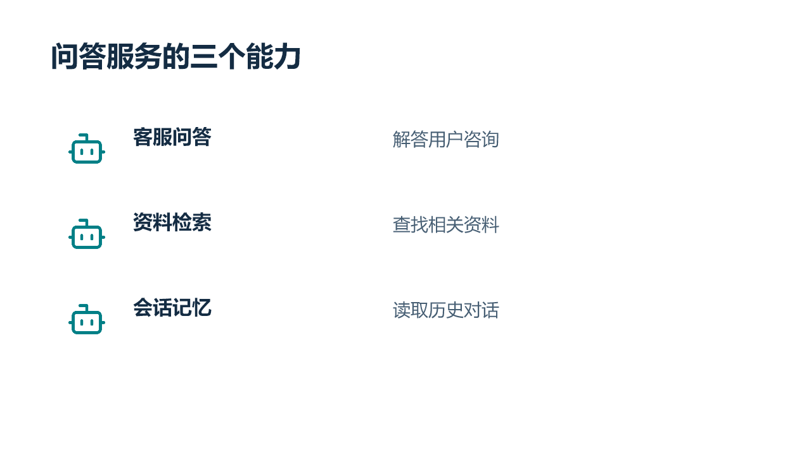
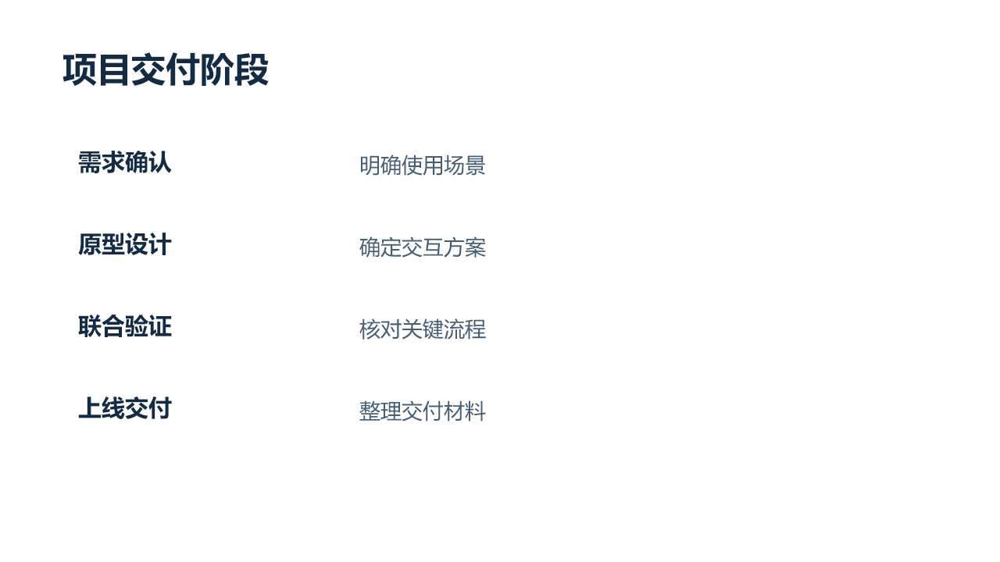
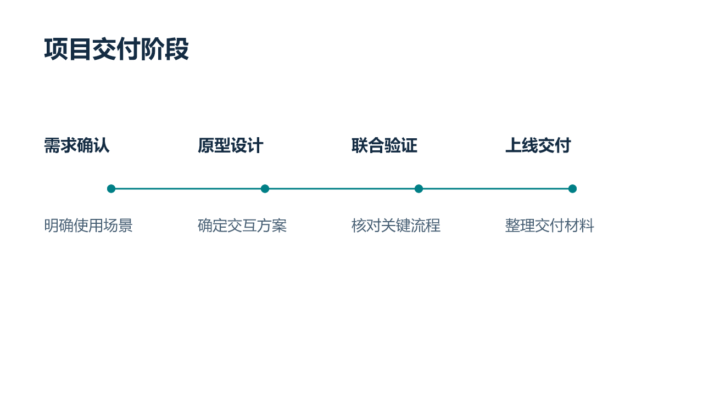
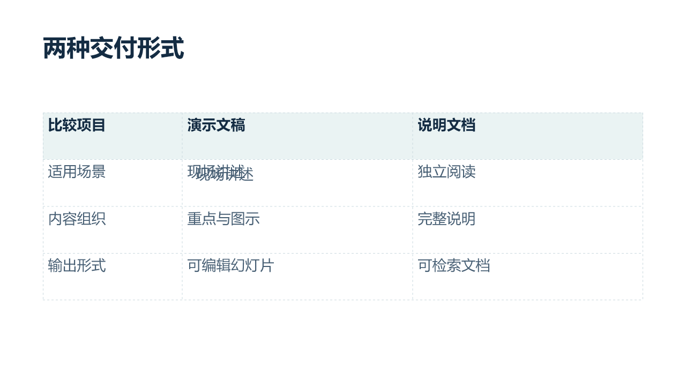
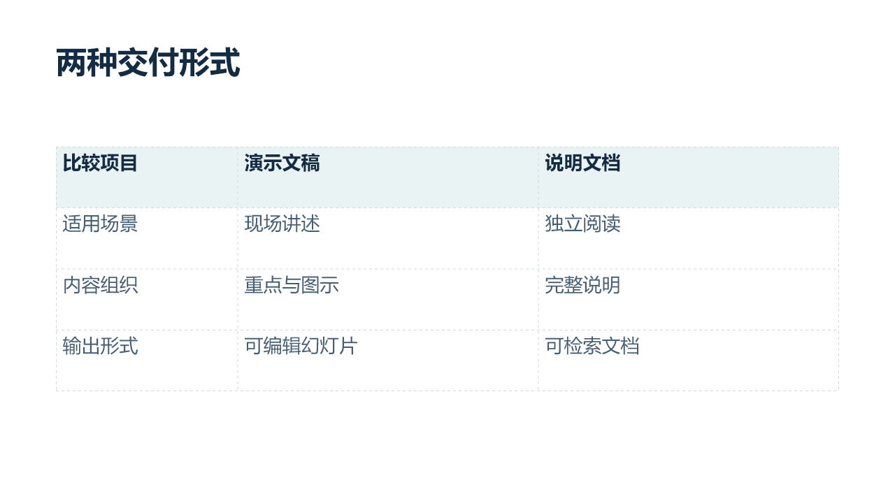

# 三页修改前后样例

这些文件使用公开合成内容，展示图标选型、时间轴构图和表格叠字修复。它们由当前 Agent 实际执行导入、编辑、导出，并逐页查看预览。它们不是独立盲测，也不表示全部七个方向或所有客户端均已验证。

这是局部编辑能力的示例，不是完整生成的默认主题、结构或风格。制作教学、研究、摄影叙事、商业提案等演示时，应重新依据目的、受众和材料规划整份 PPT，见 [完整生成流程](../references/generation.md) 与 [场景适配](../references/scenarios.md)。

- [修改前 PPTX](before.pptx)：三页合成输入，第 3 页故意保留一个重复文字层，供复现与练习。
- [修改后 PPTX](after.pptx)：保留三页及原有正文，第 1 页替换图标，第 2 页重排版式，第 3 页删除已确认的重复层。
- [验证记录](verification.json)：文件哈希、结构检查结果、实际渲染器与能力限制。

## 第 1 页：图标增强

请求：只改第 1 页的三个图标，客服问答、资料检索、会话记忆分别使用贴合含义的图标，保留文字和位置。

原稿使用相同的机器人图案。修改后分别采用耳麦、带搜索标记的文件、历史记录图案。仍保留抽象概念的短标签，图标风格和视觉尺寸保持一致。

## 第 2 页：阶段列表改为时间轴

请求：只改第 2 页构图，保留四个阶段及其说明，使用时间轴，不添加日期。

修改后使用可编辑的阶段标记、连线和文字。等距标记表达先后顺序，不代表各阶段耗时相等。

## 第 3 页：表格叠字修复

请求：修复第 3 页表格里的重叠文字，保留单元格原文和虚线分隔线。

原稿中“现场讲述”的单元格上叠加了相同文字的额外文本框。删除确认冗余的文本框后，保留原生可编辑表格，单元格文字只保留一份。

## 验证和素材边界

预览来自对**保存后的 PPTX 重新导入 Artifact Tool 2.8.106 后渲染**，并非独立绘制的示意图。已逐页查看六张前后预览。没有在 PowerPoint、WPS 或 LibreOffice 中打开确认，目标软件中的字体与排版仍需复核。结构扫描器自身仍将视觉验证标记为 `not_checked`，额外的渲染证据单独记录。

样例中的文字、表格、时间轴标记和连线均保留为原生对象。图标为嵌入的 PNG 图片，可替换但不能在 PPT 中逐笔修改；对应 SVG 源文件保存在 [assets](assets/Headset.svg) 中，便于换色或替换。

图标来自 Lucide 1.8.0，包含 Bot、Headset、FileSearch、History。保留原始图形，仅调整线色和统一线宽；来源为 [Lucide](https://lucide.dev/icons/)，适用声明见 [LUCIDE-LICENSE.txt](assets/LUCIDE-LICENSE.txt)。Skill 的 MIT 许可不替代第三方图标的许可。
